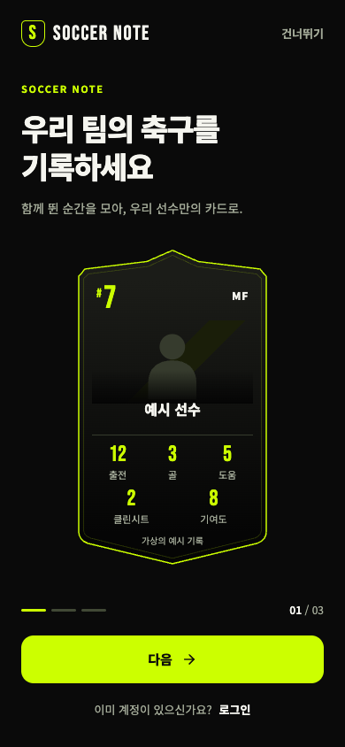
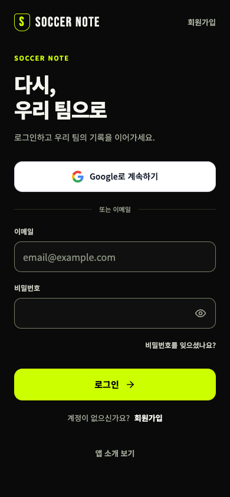

# Soccer Note entry redesign — 2026-11-01

## Scope and target
Login, signup, the public three-step introduction, and the first-team choice use the approved GOLDLINE / Volt design. Existing member records, RLS, providers, native permissions, SDKs, and database schema remain outside this change.

S2: main integration; Astra UI/UX review; one implementation owner; independent QA and auth/security review. Competitive benchmark: focused current source check and user-provided visual references. Discoverability: public root semantics checked, no indexing or new public member data. Store compliance: narrow authentication parity review; no submission/native artifact approval.

## Current production evidence
Fresh 390×844 and 1440×1000 captures: `before/landing-*`, `before/login-*`, `before/signup-*`, with metadata in `before/results.json`.

1. Root: large F splash, two account buttons, no h1. The code contains six feature slides but no reachable next action from index 0. Empty space dominates the mobile screen.
2. Login: no persistent labels on the email/password fields; `soccer note` differs from `FOOTBALL NOTE` on root and signup. Primary button uses muted olive instead of the approved solid Volt action.
3. Signup: labeled fields and a clear form exist, but spacing/branding differs from login. Code review shows its Google launch differs from the current login PKCE flow.
4. First-team choice: code-only baseline, not authenticated production evidence. Team creation is expanded immediately and invitation entry is secondary.

Before browser capture: the in-app browser host was unavailable. Public read-only screenshots were captured with the installed Playwright Chrome runtime; no credentials or production account mutation were used.

## Visual sources
- https://kr.pinterest.com/pin/988399449461815204/ — directly inspected current pin image: large left-aligned headline, short description, one central visual, low-positioned action.
- https://kr.pinterest.com/pin/141300507050901920/ — directly inspected current pin image: consistent three-screen template, one message per screen, progress and persistent account entry.
Only static images were inspected. Their animation timing and runtime behavior were not observed. Their cream/white palettes, blue buttons, characters, and illustration assets are not copied. Use existing Soccer Note player-card/match visuals with clearly fictional example records.

## Minimal current comparison context
- Apple Korea / iPhone / Business / free chart retrieved 2026-11-01: https://apps.apple.com/kr/iphone/charts/6000. Returned page lists Work24, Kakao T Picker, and Albamon first. The browsing service labels its crawl as last week; these are discovery context, not a live revenue/quality ranking or the reason for this design.
- Spond's official invitation guide (2026-09-01): https://help.spond.com/app/en/articles/131166-invite-and-add-members-to-main-groups-and-subgroups. Invitations and registration are connected; membership authorization remains a separate step. Our existing approval-pending semantics must remain intact.

## Behavior contracts
- Public root starts on step 1 of 3; no extra splash. Every next/previous/skip/login/signup path must work with buttons and keyboard. No auto-advance.
- Existing valid sessions bypass the public introduction. Short or long screens scroll naturally; meaningful controls remain at least 44px.
- Same SOCCER NOTE wordmark, Noto Sans KR Korean headings/body, Bebas Neue English/numbers, near-black base and solid Volt primary actions.
- Login/signup share labeled controls, visible focus, accessible error/loading states, and provider branding. No live member photo, name, age, or team record is exposed on public pages.
- First-team entry presents create/join equally. Creation preserves the entered name on failure and prevents duplicate requests. Pending membership remains pending.
- Only allowlisted internal destinations survive authentication. External/protocol-relative/control-character/backslash/malformed inputs fall back safely.
- Keep the current PKCE client and native callback URI. Web detectSessionInUrl handles code exchange; native deep links retain their explicit exchange. Do not duplicate web code exchange.
- Email confirmation is not a logged-in session. Profile writes require the matching authenticated session.
- Refresh stale app data after a new login, outside the synchronous auth event callback, before routing to authenticated screens.

## Verification boundaries
Unit/helper tests, typecheck, production compilation, local fixture browser flows, and deployed anonymous screens are separate evidence. Fixture auth does not prove live provider completion. Native callback compatibility review and mocks are not physical-device proof. No production account, team, membership, or player data should be created by QA.

## Implementation and independent review

The unreachable six-slide implementation was replaced by three introduction steps. Shared Entry components supply the existing fictional PlayerCard, match records and explanatory team choices; AuthScreen supplies both account forms. The no-team dashboard now reveals creation only after choosing it. Eight existing locales cover the new entry copy.

UI/UX reviewed the actual Korean 390px and 1440px screenshots and found no visual blocker. It requested a semantic role on the progress label and a small Korean wrapping refinement. Independent auth review reproduced a sequential native callback duplication: a second delivery after the first success attempted a second one-use code exchange and returned the user to login. The engineer resolved this with a bounded ref of SHA-256 fingerprints. Independent re-review found the blocker resolved and no additional blocker; ten actual-handler regression tests cover sequential/concurrent duplication, distinct new codes, effect reruns, legacy callbacks, bounded history and cleanup.

The first browser test failure was a fixture timing error: the test filled the signup email field before navigation to login completed, so the new login field was empty and no auth request was issued. Waiting for the login URL resolved it without a product change.

## Verified behavior

- Final full unit suite: 105 tests across 15 files passed. Production webpack build and TypeScript passed. Targeted ESLint had no errors and three existing warnings (two team/join effect dependencies and the pre-existing dataStore catch binding).
- Independent fixture browser flow suite: 22/22 passed (18 main scenarios plus four additional boundary cases). It covers introduction navigation, field labels/password/focus/error/loading, returning sessions, anonymous-cache login within 60 seconds, account A → logout → account B, email-confirmation signup with no profile write, signup failure recovery, invitation preservation across account screens, both Google entry routes through mocked PKCE exchange, unsafe returns, team create cancellation/failure/duplicate submission and approval-pending join.
- Intentional HTTP errors in failure fixtures and a membership-not-found `.single()` 406 are distinguished from unexpected runtime errors. No live provider login, account creation, team join or other production mutation was performed by QA.
- Eight-locale 320px record-preview metric checks show aligned numeric baselines within both rows.

- Chrome: 168 screens, covering all eight locales at 320/390/1440 CSS pixels. WebKit: 42 screens, covering Korean/German/Japanese at 320/390 CSS pixels. Both use DPR 1. No horizontal overflow, unlabelled inputs, unexpected page/console errors.
- Main flow scenarios additionally cover immediate-session signup profile failure/retry, six-second callback fallback retaining an invite, unsafe stored OAuth returns and team-create focus restoration.
- Final callback review: all 46 focused auth/helper/handler tests passed; no remaining review blocker.

## Final local evidence

Final production webpack build completed, including TypeScript and all 47 static pages. Post-fix browser QA passed 36 introduction screens: Chrome/WebKit × 320/390/1440 CSS pixels × Korean/German × three steps. Named progress groups, focus after navigation, wrapping, overflow and runtime errors all passed. The local QA build uses nonproduction placeholder Supabase values and cached original font responses. Existing framework/configuration warnings are unrelated to this change.

Production delivery is verified separately against the remote commit, the Vercel production deployment and the anonymous introduction/account screens. A successful local build does not establish production OAuth completion.

Initial deployed anonymous checks passed all ten 390/1440px introduction/account screens and their navigation, but Chrome reported the existing missing `/favicon.ico`. Root metadata now explicitly points to the existing `/app-icon-512.png`; no image asset was changed. The final production smoke check also checks console errors to catch this class of resource failure.

## Known limits

Email-confirmation signup stores the requested display name in auth metadata. The existing database trigger still initializes the profile name from the email prefix. No generic login-time rewrite or cross-device name synchronization was introduced.

The installed native app's previously reported immediate-exit problem is a separate unresolved issue; this web entry redesign is not evidence of a native launch-crash fix. Cold-start URL delivery, real Google provider completion, email-delivery settings, native artifacts and physical-device execution are not established by the fixture tests.
